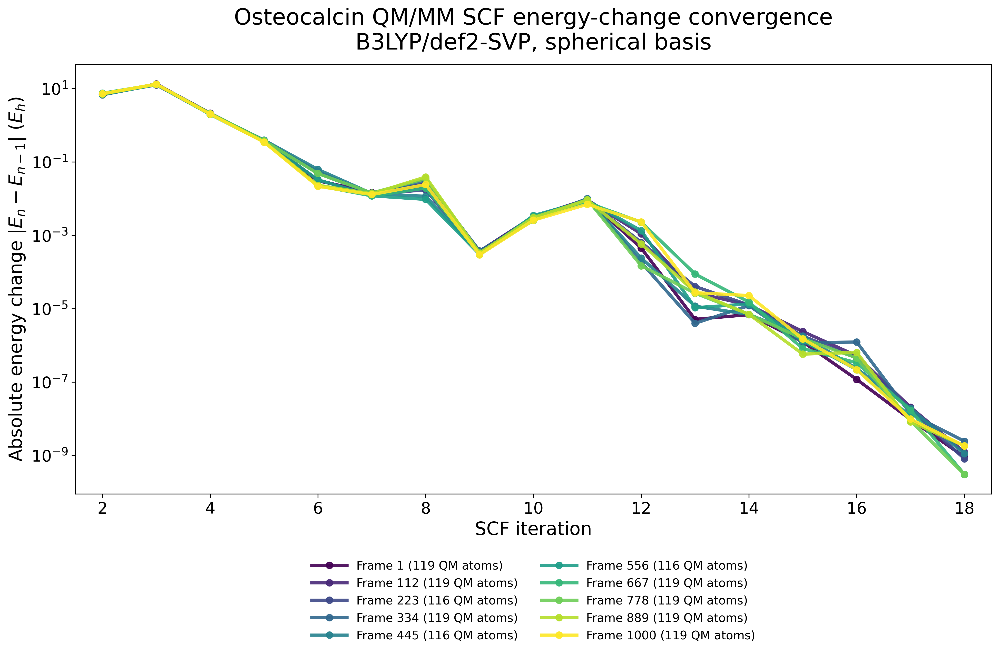
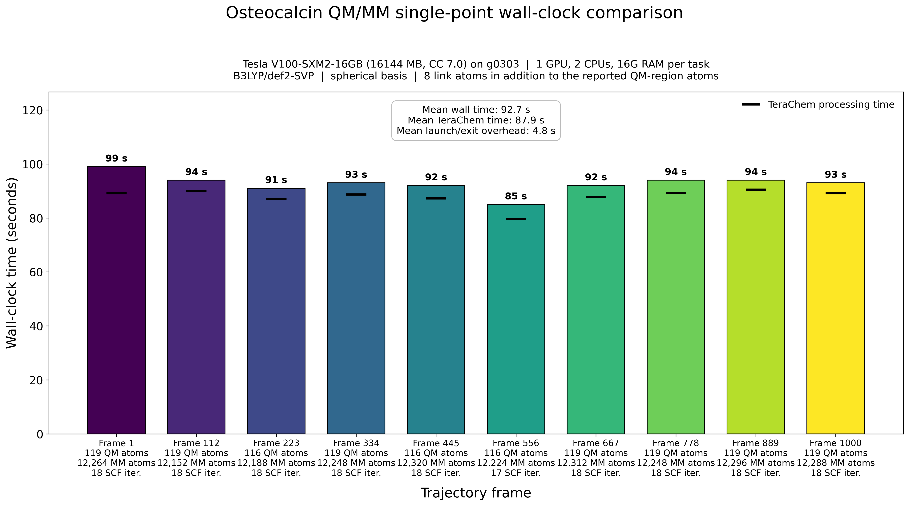

# Osteocalcin calcium-site QM/MM study

*From a calcium-bound dimer to ten trajectory-resolved electronic-structure calculations*  
27 October 2026

# Biological context

Osteocalcin is a small, vitamin-K-dependent protein secreted by osteoblasts. It is abundant in bone matrix and is also studied as a bone-derived hormone with effects beyond the skeleton. Three γ-carboxyglutamate (Gla) residues give osteocalcin a strongly anionic calcium-binding surface and help couple the protein to hydroxyapatite.

The description “folds upon binding calcium” is a useful shorthand, with one qualification: calcium binding shifts a flexible ensemble toward a more ordered, α-helical state rather than creating an entirely new fold. Early circular-dichroism measurements found a major Ca²⁺-dependent conformational change, and later solution studies likewise reported increased helical structure. For dog osteocalcin, two high-affinity Ca²⁺ sites induce the transition and three additional Ca²⁺ ions stabilize it; the calcium-saturated protein was observed as a dimer. These observations motivate the five-calcium dimer studied here.

## Study at a glance

The crystallographic monomer was expanded to the biological dimer, unresolved terminal residues were omitted, and the last resolved residue was capped. The system was parameterized with Amber ff19SB, OPC water, and calcium parameters; it was then solvated, equilibrated, and simulated for 10 ns. Ten approximately equidistant snapshots were extracted for nonperiodic, spherical QM/MM single-point calculations in TeraChem.

**Model:** calcium-bound osteocalcin dimer  
**Classical sampling:** 10 ns explicit-solvent MD  
**Electronic structure:** B3LYP/def2-SVP, spherical basis  
**Sampling:** 10 trajectory frames, evaluated independently

```{=openxml}
<w:p><w:r><w:br w:type="page"/></w:r></w:p>
```

# Editable simulation workflow

The diagram below is composed entirely of editable Word tables and text. Each selected frame feeds an independent QM/MM energy evaluation.

| **PDB / dimer assembly** | **→** | **Solvate + parameterize** | **→** | **Equilibrate + 10 ns MD** |
|:--:|:--:|:--:|:--:|:--:|
| Apply crystallographic transform; remove unresolved tail; cap resolved terminus |  | ff19SB protein · OPC water · Ca²⁺ parameters |  | Minimize → heat → NPT equilibrate → production |

**Ten approximately equidistant trajectory snapshots**

| **Frame 1** | **Frame 112** | **Frame 223** | **Frame 334** | **Frame 445** |
|:--:|:--:|:--:|:--:|:--:|
| **↓** | **↓** | **↓** | **↓** | **↓** |
| QM/MM E₁ | QM/MM E₂ | QM/MM E₃ | QM/MM E₄ | QM/MM E₅ |

| **Frame 556** | **Frame 667** | **Frame 778** | **Frame 889** | **Frame 1000** |
|:--:|:--:|:--:|:--:|:--:|
| **↓** | **↓** | **↓** | **↓** | **↓** |
| QM/MM E₆ | QM/MM E₇ | QM/MM E₈ | QM/MM E₉ | QM/MM E₁₀ |

**Common QM/MM setup:** crop a nonperiodic sphere around the protein → define the calcium coordination sites → write TeraChem QM/MM inputs → run one single-point calculation per frame.

```{=openxml}
<w:p><w:r><w:br w:type="page"/></w:r></w:p>
```

# Calcium-centered QM region

{width=5.6in}

The QM region was defined around all five Ca²⁺ ions. It contains the coordinating carboxylate side chains—principally the Gla-rich binding surface, with contacted acidic residues—and directly coordinated waters. Including the first hydration shell allows metal–ligand polarization and water–calcium interactions to be treated at the same quantum-mechanical level as the protein ligands.

Depending on the instantaneous hydration pattern, the selected snapshots contain 116 or 119 QM-region atoms. Eight link atoms complete covalent bonds cut at the QM/MM boundary and are not included in those reported atom counts. Because TeraChem QM/MM does not use periodic boundary conditions, each snapshot was cropped to a finite solvent sphere containing approximately 12,200 MM atoms.

```{=openxml}
<w:p><w:r><w:br w:type="page"/></w:r></w:p>
```

# SCF convergence across the trajectory

{width=8.2in}

All ten frames follow nearly the same convergence profile. After a shared early reorganization, the energy change drops by roughly ten orders of magnitude and reaches approximately 10⁻⁹ E~h~. Frame 556 converges in 17 iterations; the other frames converge in 18. The tight clustering indicates that the non-diffuse def2-SVP basis and spherical representation provide stable, reproducible SCF behavior across the sampled calcium environments.

```{=openxml}
<w:p><w:r><w:br w:type="page"/></w:r></w:p>
```

# Computational performance

{width=9.0in}

The ten calculations required 85–99 s each on one Tesla V100-SXM2-16GB GPU with two CPUs and 16 GB RAM per task. Mean wall time was 92.7 s, of which 87.9 s was TeraChem processing and 4.8 s was launch/exit overhead. Runtime is therefore consistent across the trajectory and dominated by the electronic-structure calculation rather than job orchestration. Since the frames are independent, the workflow is naturally parallel and the total turnaround can approach the duration of one calculation when ten GPUs are available.

## Selected sources

Hauschka, P. V. & Carr, S. A. “Calcium-dependent alpha-helical structure in osteocalcin.” *Biochemistry* **21**, 2538–2547 (1982). https://doi.org/10.1021/bi00539a038

Isbell, D. T. *et al.* “Metal ion binding to dog osteocalcin studied by ¹H NMR spectroscopy.” *Biochemistry* **32**, 11352–11362 (1993). https://pubmed.ncbi.nlm.nih.gov/8218200/

Karsenty, G. “Osteocalcin: A Multifaceted Bone-Derived Hormone.” *Annual Review of Nutrition* **43**, 55–71 (2023). https://doi.org/10.1146/annurev-nutr-061121-091348
